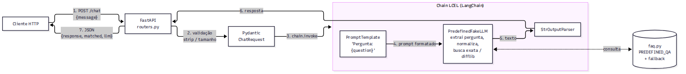

# TP2 - Parte 2 - Questão 1: Chatbot com Fake LLM (LangChain + FastAPI)

Protótipo de chatbot que responde a perguntas pré-definidas. A resposta é produzida por uma chain
LangChain (`PromptTemplate | PredefinedFakeLLM | StrOutputParser`), em que o LLM é **simulado**:
não há rede, chave de API nem custo.

## Estrutura do projeto

```text
parte2-q1-fake-llm-chatbot/
├── main.py           # cria o FastAPI e roda o uvicorn
├── routers.py        # APIRouter: GET /health, GET /questions, POST /chat
├── models.py         # schemas Pydantic (ChatRequest / ChatResponse)
├── services.py       # PredefinedFakeLLM (subclasse de LLM), chain LCEL e ChatService
├── faq.py            # perguntas/respostas pré-definidas e resposta padrão
├── config.py
├── requirements.txt
├── pytest.ini
└── tests/test_api.py
```

## Arquitetura e fluxo de dados



1. O cliente envia `POST /chat` com `{"message": "..."}`.
2. O Pydantic valida a mensagem (remove espaços, recusa vazio, máx. 500 caracteres).
3. O `ChatService` chama `chain.invoke({"question": message})`.
4. O `PromptTemplate` monta o prompt (`... Pergunta: {question} Resposta:`).
5. O `PredefinedFakeLLM` extrai a pergunta do prompt, normaliza (minúsculas, sem acentos e sem
   pontuação), procura uma correspondência exata em `faq.py` e, se não achar, a mais parecida com
   `difflib.get_close_matches(cutoff=0.6)`, o que tolera erros de digitação. Sem correspondência,
   devolve a resposta padrão.
6. O `StrOutputParser` devolve a string.
7. A API responde em JSON com `response`, `matched` e `llm: "fake"`. `matched` indica se a pergunta
   foi encontrada no FAQ; se o LLM da chain for trocado (ex.: `FakeListLLM`, `ChatOpenAI`), o FAQ não é
   consultado e `matched` vem `null`.

## Por que usar um Fake LLM para testes rápidos

- **Determinismo:** a mesma entrada sempre gera a mesma saída, então os testes não ficam instáveis.
- **Custo zero e sem API key:** nenhuma chamada paga, roda em CI e em máquinas sem credenciais.
- **Velocidade:** ~1,5 ms por requisição (200 requisições simultâneas em 0,47 s), contra centenas de
  ms a segundos de um LLM real.
  A suíte de testes inteira roda em menos de 1 s.
- **Sem rede:** funciona offline e não sofre com rate limit, timeout ou indisponibilidade do provedor.
- **Isolamento:** testa prompt, chain, validação e contrato da API separadamente do modelo. Como o
  LLM é só um componente da chain, dá para trocar o fake por um modelo real (ex.: `ChatOpenAI`) sem
  mexer no resto. Os testes mostram isso trocando o `PredefinedFakeLLM` pelo `FakeListLLM` oficial
  do LangChain.
- **Cenários controlados:** permite simular respostas específicas, incluindo erros e casos de borda,
  difíceis de reproduzir com um LLM real.

## Requisitos

- Python 3.10 ou superior. Não baixa modelos.

## Configuração do ambiente de desenvolvimento

```bash
cd parte2-q1-fake-llm-chatbot
python -m venv .venv
source .venv/bin/activate          # Windows (PowerShell): .\.venv\Scripts\Activate.ps1
pip install -r requirements.txt
```

## Execução

```bash
python main.py
# ou, em desenvolvimento, com recarga automatica ao salvar (como na Etapa 1):
uvicorn main:app --port 8011 --reload
```

A API sobe em `http://127.0.0.1:8011` e o Swagger fica em `http://127.0.0.1:8011/docs`.

## Endpoints

| Método | Rota         | Descrição                                   |
|--------|--------------|---------------------------------------------|
| GET    | `/health`    | status                                      |
| GET    | `/questions` | lista as perguntas pré-definidas            |
| POST   | `/chat`      | envia uma mensagem e recebe a resposta      |

## Exemplos de uso

```bash
curl -X POST http://127.0.0.1:8011/chat \
  -H "Content-Type: application/json" \
  -d '{"message": "O que é LangChain?"}'
```

```json
{
  "message": "O que é LangChain?",
  "response": "LangChain é um framework para construir aplicações com LLMs, compondo prompts, modelos, parsers, memória e ferramentas em cadeias (chains).",
  "matched": true,
  "llm": "fake"
}
```

Pergunta desconhecida (resposta padrão):

```bash
curl -X POST http://127.0.0.1:8011/chat -H "Content-Type: application/json" -d '{"message": "Quanto é 2+2?"}'
```

```json
{
  "message": "Quanto é 2+2?",
  "response": "Desculpe, não sei responder a essa pergunta. Consulte GET /questions para ver as perguntas que eu conheço.",
  "matched": false,
  "llm": "fake"
}
```

Perguntas disponíveis:

```bash
curl http://127.0.0.1:8011/questions
```

```json
{"questions": ["ola", "qual seu nome", "o que e langchain", "o que e fastapi", "o que e fake llm",
               "qual o horario de atendimento", "como entro em contato", "tchau"]}
```

Para adicionar perguntas, edite `faq.py`. As chaves ficam normalizadas, ou seja, em minúsculas, sem
acento e sem pontuação.

## Testes

```bash
pytest
```
