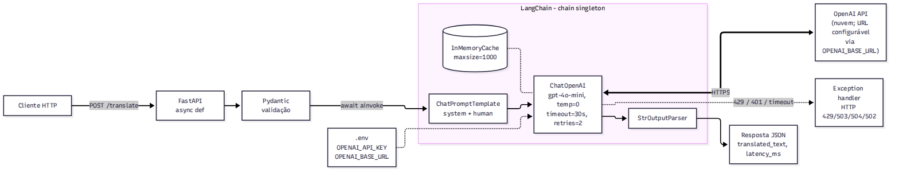

# TP2 - Parte 2 - Questão 2: Tradução EN -> FR com OpenAI via LangChain (FastAPI)

API de tradução (inglês -> francês) semelhante à Parte 1 - Questão 2, mas usando um modelo da OpenAI
(padrão: `gpt-4o-mini`) orquestrado pelo LangChain:
`ChatPromptTemplate | ChatOpenAI | StrOutputParser`.

Funciona com **qualquer API compatível com a da OpenAI**: basta apontar `OPENAI_BASE_URL` para o
provedor (DeepSeek, OpenRouter, Ollama, vLLM...). As medições reais deste trabalho foram feitas no
[DeepSeek](https://api-docs.deepseek.com/) com o modelo `deepseek-flash`.

## Estrutura do projeto

```text
parte2-q2-langchain-openai-translation/
├── main.py           # FastAPI, lifespan (monta a chain), handler de erros do provedor, uvicorn
├── routers.py        # APIRouter: GET /health e POST /translate (async)
├── models.py         # schemas Pydantic
├── services.py       # chain LangChain, ChatOpenAI, cache, mapeamento de erros da OpenAI
├── config.py         # lê .env (OPENAI_API_KEY, OPENAI_MODEL, timeout, retries)
├── .env.example      # modelo do arquivo .env
├── requirements.txt
├── pytest.ini
└── tests/test_api.py # usa FakeListChatModel: nenhuma chamada real à OpenAI
```

## Arquitetura



## Como a aplicação gerencia as chamadas e reduz a latência

- **Endpoint `async def` + `await chain.ainvoke(...)`:** a espera pela OpenAI (I/O de rede) não ocupa
  threads, então o servidor atende muitas traduções concorrentes num único processo.
- **Chain e cliente singleton:** `ChatOpenAI` é criado uma vez e reaproveita as conexões HTTP
  (keep-alive), sem repetir o handshake TLS a cada requisição.
- **`gpt-4o-mini`:** modelo rápido e barato, adequado para tradução.
- **`temperature=0`:** saída determinística, o que também permite usar o cache.
- **Cache em memória (`InMemoryCache(maxsize=1000)`):** um texto repetido volta na hora, sem nova
  chamada nem custo. O limite evita que textos distintos façam a memória crescer sem fim.
- **`timeout=30s` e `max_retries=2`:** a requisição não fica pendurada, e falhas transitórias
  (ex.: 429, 5xx) são repetidas com backoff pelo SDK.
- **Prompt enxuto:** o system prompt pede só a tradução, sem explicações, o que reduz os tokens de saída.
- **Erros tratados** e devolvidos em JSON:

| Erro da OpenAI                       | HTTP da API |
|--------------------------------------|-------------|
| `RateLimitError` (limite RPM/TPM)    | 429         |
| `AuthenticationError` / sem chave    | 503         |
| `RateLimitError` com `insufficient_quota` (conta sem créditos) | 503 |
| resposta vazia do modelo             | 502         |
| `APITimeoutError`                    | 504         |
| `APIConnectionError` / outros status | 502         |

## Requisitos

- Python 3.10 ou superior
- Uma chave de API da OpenAI com créditos (https://platform.openai.com/api-keys)

## Configuração do ambiente de desenvolvimento

```bash
cd parte2-q2-langchain-openai-translation
python -m venv .venv
source .venv/bin/activate          # Windows (PowerShell): .\.venv\Scripts\Activate.ps1
pip install -r requirements.txt
cp .env.example .env               # edite e coloque sua OPENAI_API_KEY
```

Variáveis do `.env`:

| Variável                  | Padrão          | Descrição                                                    |
|---------------------------|-----------------|--------------------------------------------------------------|
| `LLM_PROVIDER`            | deduzido da URL | preset: `openai` ou `deepseek`; sem ele, é deduzido da `OPENAI_BASE_URL` |
| `OPENAI_API_KEY`          | -               | chave genérica (vale para qualquer provedor)                 |
| `DEEPSEEK_API_KEY`        | -               | chave específica; tem prioridade sobre `OPENAI_API_KEY`      |
| `OPENAI_MODEL`            | do preset       | modelo de chat usado                                         |
| `OPENAI_BASE_URL`         | do preset       | URL da API compatível; vazio = `https://api.openai.com/v1`   |
| `OPENAI_REASONING_EFFORT` | do preset       | modelos de raciocínio no padrão OpenAI (série `o` da OpenAI): `low`/`medium`/`high` |
| `OPENAI_THINKING`         | do preset       | DeepSeek: `enabled`/`disabled`                               |
| `OPENAI_TIMEOUT`          | `30`            | timeout por chamada (segundos)                               |
| `OPENAI_MAX_RETRIES`      | `2`             | tentativas extras em falhas                                  |
| `CACHE_MAXSIZE`           | `1000`          | entradas do cache em memória; `0` desliga                    |

### Provedores

| Provedor  | URL base                         | Modelo padrão        | Ajuste do preset                                   |
|-----------|----------------------------------|----------------------|----------------------------------------------------|
| OpenAI    | `https://api.openai.com/v1`      | `gpt-4o-mini`        | -                                                  |
| [DeepSeek](https://api-docs.deepseek.com/) | `https://api.deepseek.com` | `deepseek-flash` | `OPENAI_THINKING=disabled` (enviado como `{"thinking": {"type": "disabled"}}` via `extra_body`) |

Exemplos de `.env`:

```bash
# DeepSeek: basta URL + modelo + chave (o preset é deduzido da URL)
OPENAI_API_KEY=sk-...
OPENAI_BASE_URL=https://api.deepseek.com
OPENAI_MODEL=deepseek-flash          # ou deepseek-v4-pro

# Qualquer outra API compatível (ex.: Ollama local)
OPENAI_API_KEY=ollama
OPENAI_BASE_URL=http://localhost:11434/v1
OPENAI_MODEL=llama3.2
```

`GET /health` mostra o provedor e a URL em uso (`"provider": "deepseek"`, `"base_url": ...`).

Por que o preset do DeepSeek desliga o raciocínio: ele vem ligado por padrão (esforço `high`) e,
ligado, ignora `temperature`. Medido: a mesma frase saiu idêntica, mas com 147 tokens de saída (131 de
raciocínio) contra 15, ou seja, cerca de 10 vezes o custo de saída sem ganho de qualidade.

Atenção: variáveis definidas no shell (ex.: um `DEEPSEEK_API_KEY` antigo exportado no `~/.zshrc`)
têm prioridade sobre o `.env`.

Se a resposta vier vazia, a API devolve `502` com orientação.

O `.env` está no `.gitignore` e não deve ser versionado.

## Execução

```bash
python main.py
# ou, em desenvolvimento, com recarga automatica ao salvar (como na Etapa 1):
uvicorn main:app --port 8012 --reload
```

A API sobe em `http://127.0.0.1:8012` e o Swagger fica em `http://127.0.0.1:8012/docs`.
Sem a `OPENAI_API_KEY`, a aplicação sobe, registra o erro no log, `GET /health` mostra
`"api_key_configured": false` e `POST /translate` responde `503`.

## Endpoints

| Método | Rota         | Descrição                                  |
|--------|--------------|--------------------------------------------|
| GET    | `/health`    | status, modelo, URL base e se a chave está configurada |
| POST   | `/translate` | traduz `text` de inglês para francês       |

## Exemplos de uso

```bash
curl -X POST http://127.0.0.1:8012/translate \
  -H "Content-Type: application/json" \
  -d '{"text": "Hello, how are you? It is raining cats and dogs."}'
```

Resposta real (DeepSeek, `deepseek-flash`):

```json
{
  "source_text": "Hello, how are you? It is raining cats and dogs.",
  "translated_text": "Bonjour, comment allez-vous ? Il pleut des cordes.",
  "source_lang": "en",
  "target_lang": "fr",
  "model": "deepseek-flash",
  "latency_ms": 1118.8
}
```

Repita a mesma requisição: com o cache, o `latency_ms` cai para ~1 ms (~15 ms de ponta a ponta),
contra ~1,1 s da primeira chamada, e não há nova chamada ao provedor.

Sem chave configurada:

```json
{"detail": "Chave de API não configurada para o provedor 'openai' (OPENAI_API_KEY ou a chave específica, ex.: DEEPSEEK_API_KEY). Crie o arquivo .env a partir de .env.example."}
```

## Testes

```bash
pytest
```

Os testes trocam o `ChatOpenAI` por `FakeListChatModel` (LangChain), usando a mesma chain e o mesmo
prompt. Também verificam o mapeamento de cada exceção da OpenAI para o status HTTP correspondente.
Nenhuma chamada real é feita, e não é preciso ter chave.
