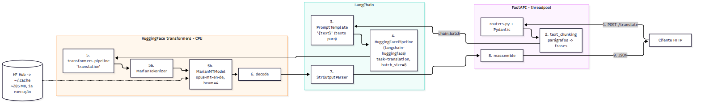

# TP2 - Parte 2 - Questão 3: Tradução EN -> DE com LangChain + HuggingFace (Helsinki-NLP/opus-mt-en-de)

API FastAPI que traduz textos do inglês para o alemão com o modelo
[Helsinki-NLP/opus-mt-en-de](https://huggingface.co/Helsinki-NLP/opus-mt-en-de), executado
localmente (CPU). As chamadas ao modelo são gerenciadas pelo LangChain:
`PromptTemplate | HuggingFacePipeline | StrOutputParser` (pacote `langchain-huggingface`).

## Estrutura do projeto

```text
parte2-q3-langchain-hf-translation-en-de/
├── main.py              # FastAPI, lifespan (pré-carrega o modelo), handler de erro, uvicorn
├── routers.py           # APIRouter: GET /health e POST /translate
├── models.py            # schemas Pydantic
├── services.py          # chain LangChain + TranslationService (chunking + chain.batch)
├── model_loader.py      # carrega o modelo 1x; memoriza falhas de carga (503 + nova tentativa)
├── text_chunking.py     # divisão de textos longos (mesmo algoritmo da Parte 1 - Q2)
├── config.py
├── requirements.txt
├── pytest.ini
└── tests/
    ├── test_api.py           # usa FakeListLLM do LangChain (não baixa o modelo)
    ├── test_text_chunking.py
    └── test_model_loader.py
```

## Arquitetura



1. `POST /translate` recebe `{"text": ...}`, validado pelo Pydantic.
2. `text_chunking` divide o texto em parágrafos e frases.
3. `chain.batch([...])` envia todos os chunks à chain. O `PromptTemplate("{text}")` passa o texto
   puro, porque o Marian não segue instruções: qualquer instrução extra seria traduzida junto.
4. O `HuggingFacePipeline` (criado com `from_model_id(task="translation", batch_size=8,
   pipeline_kwargs={"num_beams": 4, "max_new_tokens": 512})`) recebe todos os prompts numa única
   chamada e os repassa ao `transformers.pipeline("translation")` em lotes de 8.
5. `MarianTokenizer` (SentencePiece) gera os ids, e o `MarianMTModel` (PyTorch, CPU) roda
   `generate` com `num_beams=4`.
6. O pipeline decodifica os ids no texto alemão, e o `StrOutputParser` devolve as strings.
7. As frases são remontadas e a resposta JSON inclui `chunks` e `latency_ms`.

Os pesos (~285 MB) são baixados do HuggingFace Hub na primeira execução, ficam em
`~/.cache/huggingface` e são carregados uma vez na inicialização.

### Versão do transformers

O `HuggingFacePipeline` só aceita pipelines das tasks `text-generation`, `text2text-generation`,
`summarization` e `translation`, e a task `translation` foi removida no transformers 5.x
(`KeyError: 'The task translation has been removed from transformers...'`). Por isso o
`requirements.txt` fixa `transformers==4.57.6` (com `tokenizers==0.22.2` e `huggingface-hub==0.36.2`).

## Requisitos

- Python 3.10 ou superior (testado com 3.14)
- ~1 GB de RAM livre e ~300 MB de disco para o modelo
- Não precisa de GPU (PyTorch somente CPU)

## Configuração do ambiente de desenvolvimento

```bash
cd parte2-q3-langchain-hf-translation-en-de
python -m venv .venv
source .venv/bin/activate          # Windows (PowerShell): .\.venv\Scripts\Activate.ps1
pip install -r requirements.txt
```

Em macOS, remova o sufixo `+cpu` da linha do `torch` no `requirements.txt`.

## Execução

```bash
python main.py
# ou, em desenvolvimento, com recarga automatica ao salvar (como na Etapa 1):
uvicorn main:app --port 8013 --reload
```

A API sobe em `http://127.0.0.1:8013` e o Swagger fica em `http://127.0.0.1:8013/docs`.

`GET /health` responde `200` com `"model_loaded": true` quando o modelo está pronto, e `503` com
`"model_loaded": false` se o carregamento falhou. Após uma falha, as requisições recebem `503`
imediatamente e uma nova tentativa de carga só ocorre depois de `LOAD_RETRY_SECONDS` (padrão 30 s).

## Endpoints

| Método | Rota         | Descrição                              |
|--------|--------------|----------------------------------------|
| GET    | `/health`    | status, modelo, framework e `model_loaded` |
| POST   | `/translate` | traduz `text` de inglês para alemão    |

## Exemplos de uso

```bash
curl -X POST http://127.0.0.1:8013/translate \
  -H "Content-Type: application/json" \
  -d '{"text": "Hello, how are you? I hope you are having a great day."}'
```

Resposta (real, CPU):

```json
{
  "source_text": "Hello, how are you? I hope you are having a great day.",
  "translated_text": "Hallo, wie geht's? Ich hoffe, Sie haben einen tollen Tag.",
  "source_lang": "en",
  "target_lang": "de",
  "model": "Helsinki-NLP/opus-mt-en-de",
  "framework": "langchain+huggingface",
  "chunks": 2,
  "latency_ms": 310.8
}
```

Texto com parágrafos:

```bash
curl -X POST http://127.0.0.1:8013/translate \
  -H "Content-Type: application/json" \
  -d '{"text": "The weather is nice today.\n\nLet us go to the park."}'
```

Texto vazio ou acima de 5000 caracteres retorna `422`. Falha no modelo retorna `503`.

## Testes

```bash
pytest
```

Os testes montam a mesma chain com `FakeListLLM` no lugar do `HuggingFacePipeline`, o que valida
chunking, `chain.batch`, remontagem e o contrato da API sem baixar o modelo.
