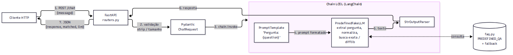
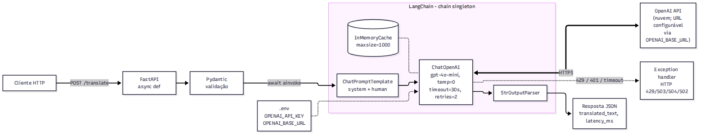
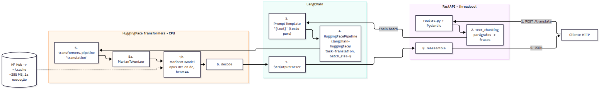

# TP2: APIs com FastAPI e LangChain usando LLMs — Relatório final

Este relatório reúne as explicações, tabelas e diagramas pedidos para as questões teóricas:

- **Parte 1:** Questão 3 (limitações do opus-mt-en-fr) e Questão 4 (limitações do GPT-2).
- **Parte 2:** Questão 4 (limitações de LangChain + OpenAI), Questão 5 (limitações de LangChain +
  HuggingFace) e Questão 6 (tabela comparativa FastAPI puro x LangChain).
- **Anexo:** diagramas de arquitetura das aplicações da Parte 2 (Questões 1 a 3).

O código das aplicações, os testes e o script de medição estão nas pastas do projeto, descritas no
`README.md` da raiz.

## Sumário

1. [Ambiente e medições de referência](#1-ambiente-e-medições-de-referência)
2. [Parte 1 - Questão 3: Limitações do opus-mt-en-fr](#2-parte-1---questão-3-limitações-do-modelo-de-tradução-helsinki-nlpopus-mt-en-fr)
3. [Parte 1 - Questão 4: Limitações do GPT-2](#3-parte-1---questão-4-limitações-do-gpt-2-na-geração-de-texto)
4. [Parte 2 - Questão 4: Limitações de LangChain + OpenAI](#4-parte-2---questão-4-limitações-de-usar-langchain-para-integrar-a-api-da-openai)
5. [Parte 2 - Questão 5: Limitações de LangChain + HuggingFace](#5-parte-2---questão-5-limitações-de-usar-langchain-para-integrar-o-modelo-huggingface)
6. [Parte 2 - Questão 6: Tabela comparativa FastAPI puro x LangChain](#6-parte-2---questão-6-tabela-comparativa-fastapi-puro-x-langchain)
7. [Anexo: diagramas de arquitetura (Parte 2, Questões 1 a 3)](#7-anexo-diagramas-de-arquitetura-parte-2-questões-1-a-3)
8. [Conclusões](#8-conclusões)
9. [Uso de IA](#9-uso-de-ia)

## 1. Ambiente e medições de referência

Medições feitas em notebook com WSL2 (Ubuntu 24.04), 12 vCPUs, ~7 GB de RAM, **sem GPU**, Python 3.14, PyTorch 2.15 (CPU), transformers 4.57.6 e LangChain-core 1.7. As latências são medianas de 3 execuções do script [`docs/benchmark.py`](docs/benchmark.py) contra as APIs rodando localmente (resultados brutos em [`docs/benchmark_results.json`](docs/benchmark_results.json)).

| Aplicação | Entrada | Latência (mediana) | RAM do processo | Pesos do modelo |
|---|---|---|---|---|
| P1 Q1 GPT-2 | 20 / 100 / 200 tokens gerados | 0,81 / 3,3 / 7,4 s | ~1.040 MB | 523 MB |
| P1 Q1 GPT-2 | 8 requisições simultâneas de 50 tokens | 25,3 s no total (0,32 req/s) | | |
| P1 Q2 opus-mt-en-fr | frase curta (2 frases) | 0,27 s | ~850 MB | 287 MB |
| P1 Q2 opus-mt-en-fr | texto longo (~3.300 caracteres, 40 frases) | 7,0 s | | |
| P1 Q2 opus-mt-en-fr | 8 requisições curtas simultâneas | 4,7 s no total (1,7 req/s) | | |
| P2 Q2 LangChain + API compatível com OpenAI (DeepSeek `deepseek-flash`) | frase curta / texto longo | 0,99 s / 3,1 s (cache: 15 ms) | ~115 MB | - (remoto) |
| P2 Q2 LangChain + API compatível com OpenAI | 8 requisições curtas simultâneas | 1,4 s no total (5,6 req/s), sem 429 | | |
| P2 Q3 LangChain + opus-mt-en-de | frase curta / texto longo | 0,21 s / 4,2 s | ~930 MB | 285 MB |
| P2 Q3 LangChain + opus-mt-en-de | 8 requisições curtas simultâneas | 3,7 s no total (2,2 req/s) | | |

Todas as questões abaixo citam os números desta tabela.

## 2. Parte 1 - Questão 3: Limitações do modelo de tradução Helsinki-NLP/opus-mt-en-fr

**Enunciado:** Com base na API da Questão 2 (Parte 1), explique as principais limitações do modelo de tradução utilizado: precisão da tradução; tempo de resposta e desempenho em grande escala; custo e escalabilidade; gírias, expressões idiomáticas e linguagem de contexto.

Aplicação analisada: [Parte 1 - Questão 2 (FastAPI + Helsinki-NLP/opus-mt-en-fr)](parte1-q2-translation-en-fr/).

### Resposta

O `opus-mt-en-fr` é um modelo MarianMT (Transformer encoder-decoder, ~75M parâmetros) treinado com o
corpus paralelo OPUS. É pequeno, gratuito e roda em CPU.

#### 1. Precisão da tradução

O modelo aprendeu com pares de frases isoladas e não enxerga o documento. Pronomes, gênero e termos
que dependem de frases anteriores perdem a referência, e textos longos ficam inconsistentes.

O problema mais grave aparece quando ele recebe várias frases de uma vez: pode descartar parte delas.
A entrada `"Hello, how are you? It is raining cats and dogs."` enviada inteira volta só como
`"Il pleut des chats et des chiens."`.

Num texto de 60 frases agrupadas em 3 blocos, a saída teve 2.822 caracteres. Frase a frase, foram
6.899. **O modelo jogou fora mais da metade do conteúdo.**

E a falha não avisa. A resposta parece fluente, só que está incompleta. Por isso a API traduz frase a
frase, em batch.

Outros pontos fracos:

- **Ambiguidade.** Em `"The bank was closed, so we sat on the bank of the river."`, o modelo
  devolveu `"La rive était fermée, alors nous nous sommes assis sur la rive de la rivière."` e usou
  "rive" (margem) para os dois sentidos de "bank".
  O modelo alemão (P2 Q3) acertou a mesma frase (`"Die Bank war geschlossen ... am Ufer des Flusses"`).
  A qualidade muda conforme o par de idiomas.
- **Frases longas.** Acima de 512 tokens o texto seria cortado, e a qualidade cai antes disso. A API
  resolve com chunking.
- **Domínio.** O OPUS vai bem em textos genéricos (legendas, documentos da UE, software) e mal em
  termos médicos, jurídicos ou técnicos muito específicos.
- **Formalidade.** Não dá para escolher entre tu e vous. O modelo decide sozinho.
- A API não tem como saber quando a tradução está errada, porque o modelo não informa confiança.

#### 2. Tempo de resposta e desempenho em grande escala

A latência cresce linearmente com o tamanho do texto: 0,27 s para duas frases e 7,0 s para ~3.300
caracteres em CPU. A decodificação gera um token por vez, e o beam search (`num_beams=4`) multiplica o custo.

Com várias requisições ao mesmo tempo, piora. Oito requisições curtas simultâneas levaram 4,7 s no
total (1,7 req/s), e cada cliente esperou ~4,5 s. Sozinha, a mesma requisição leva 0,27 s.

Em sequência, as oito terminariam em ~2,2 s. A concorrência atrapalha porque o PyTorch já usa todos
os núcleos em cada inferência, e as threads do FastAPI passam a disputar os mesmos núcleos.
O threadpool impede que o servidor trave, mas não cria capacidade de processamento.

- **Cold start.** O primeiro uso baixa ~300 MB do HuggingFace Hub, e carregar o modelo leva alguns
  segundos. Em autoscaling, cada réplica nova paga esse custo.
- **Memória.** ~850 MB de RAM por processo. Cada worker do Uvicorn carrega outra cópia do modelo.
- **O que ajuda:** GPU, quantização (int8) ou conversão para ONNX/CTranslate2, micro-batching de
  requisições concorrentes, `num_beams` menor (perde qualidade, ganha velocidade) e cache de
  traduções repetidas.

#### 3. Custo e escalabilidade

Não há custo por requisição: o modelo é aberto (licença CC-BY 4.0). O custo está na
**infraestrutura fixa**. Os servidores ficam ligados mesmo sem uso, e GPU custa caro.

Escalar na horizontal pesa. Cada réplica precisa de ~1 GB de RAM e de alguns segundos para aquecer,
então a equipe tem que dimensionar para o pico. Numa API paga por uso, isso não acontece.

- **Um modelo por par de idiomas.** Atender N idiomas significa carregar e manter vários modelos
  (en-fr, en-de, fr-en...), e a memória e a operação crescem junto. Um LLM multilíngue faz tudo com um só.
- **Operação.** Monitoramento, atualização de dependências e cache de modelos ficam com a equipe.

#### 4. Gírias, expressões idiomáticas e linguagem de contexto

O modelo traduz palavra por palavra. Saídas reais da API:

| Inglês                             | Saída do opus-mt-en-fr                        | Tradução idiomática esperada           |
|------------------------------------|-----------------------------------------------|----------------------------------------|
| It's raining cats and dogs.        | Il pleut des chats et des chiens.             | Il pleut des cordes.                   |
| Break a leg tonight!               | Brisez une jambe ce soir !                    | Merde pour ce soir !                   |
| That exam was a piece of cake.     | Cet examen était un morceau de gâteau.        | Cet examen était du gâteau.            |
| He kicked the bucket last year.    | Il a donné un coup de pied l'an dernier.      | Il a cassé sa pipe l'an dernier.       |
| Let's call it a day.               | C'est un jour.                                | On s'arrête là pour aujourd'hui.       |
| I'm feeling under the weather.     | Je me sens sous la météo.                     | Je ne me sens pas très bien.           |
| That's lit, bro, no cap.           | C'est allumé, frérot, pas de casquette.       | C'est génial, frérot, sans mentir.     |

Gírias recentes ("lit", "no cap") não existem no corpus de treino. Expressões idiomáticas viram
traduções literais sem sentido, ou com o sentido trocado: "kicked the bucket" virou um chute.

Ironia, sarcasmo, referências culturais e tudo o que depende da conversa também se perdem. O modelo
vê uma frase por vez.

## 3. Parte 1 - Questão 4: Limitações do GPT-2 na geração de texto

**Enunciado:** Com base no modelo GPT-2 da Questão 1 (Parte 1), explique as principais limitações do modelo na geração de texto: coerência do texto gerado; falhas ou incoerências geradas por LLMs; desempenho e latência; geração de conteúdo apropriado.

Aplicação analisada: [Parte 1 - Questão 1 (FastAPI + GPT-2)](parte1-q1-gpt2-text-generation/).

### Resposta

O GPT-2 (versão base, 124M parâmetros, 2019) é um modelo autoregressivo **treinado só para prever o
próximo token** (WebText, em inglês). Não passou por ajuste de instruções nem por RLHF. Ele completa
texto, mas não responde perguntas nem segue comandos.

#### 1. Coerência do texto gerado

As frases saem gramaticais, mas o texto perde o fio depois de poucas sentenças. Um exemplo real, com
o prompt "Once upon a time in a small village,":

> *"a young boy was brought here in his early twenties by his parents. The boy was a boy who wanted to
> get his father to join him in life."*

Um "boy" de vinte e poucos anos e uma frase que anda em círculo.

- **Contexto curto.** A janela é de 1.024 tokens, mas na prática o modelo "esquece" o tema bem antes.
- **Repetição ou deriva.** Sem `no_repeat_ngram_size` e sem amostragem (`top_p`, `temperature`), o
  modelo entra em loop ("The boy was a boy..."). Com temperatura alta, foge para assuntos sem relação.
  Os parâmetros da API (`temperature=0.9`, `top_k=50`, `top_p=0.95`, `no_repeat_ngram_size=3`)
  buscam um meio-termo entre os dois problemas.
- **Cada chamada dá um texto diferente.** É o efeito da amostragem. Para reproduzir um resultado, a
  API aceita `seed`.

#### 2. Falhas e incoerências típicas de LLMs

O GPT-2 inventa fatos. Para o prompt *"The capital of Brazil is"*, ele gerou:

> *"known for its military, which in turn includes the military wing of the Brazilian military and the
> elite military organization known as the 'Tibetan Democratic Guard'"*

Não disse "Brasília" e ainda criou uma organização que não existe. O modelo busca o texto mais
plausível, não o verdadeiro.

- **Frases vazias.** *"it is still hard to see how we can make an AI that is completely compatible
  with artificial intelligence"* parece um argumento, mas é tautológico.
- **Instruções ignoradas.** Pedir "Translate to French: ..." ou "Answer the question: ..." não
  funciona de forma confiável. O modelo só continua o texto.
- **Conhecimento parado em 2019 e só em inglês.** Prompts em português geram texto ruim.
- **Contas e lógica.** Erra contas simples e cadeias de raciocínio.

#### 3. Desempenho e latência

A latência acompanha o número de tokens gerados. Em CPU: 0,81 s para 20 tokens, 3,3 s para 100 e
7,4 s para 200, ou ~35 ms por token.

Cada token depende dos anteriores, então a geração é sequencial e não paraleliza dentro de uma
requisição. O processo ocupa ~1.040 MB de RAM, com 523 MB de pesos, e o cold start inclui download e
carregamento.

Com concorrência, a conta piora. Oito requisições simultâneas de 50 tokens levaram 25,3 s
(0,32 req/s). Cada usuário esperou ~25 s por um texto que, sozinho, sairia em ~1,8 s.

Em produção, isso pede GPU, batching dinâmico (vLLM, TGI) e streaming de tokens para o usuário ver o
texto chegando. Também pede limite de `max_new_tokens`, que a API já aplica (máx. 200).

#### 4. Geração de conteúdo apropriado

O WebText vem de links do Reddit, e o modelo herdou o viés e a toxicidade desses dados. A própria
OpenAI documenta vieses de gênero, raça e religião no GPT-2. Um prompt inocente pode gerar conteúdo
ofensivo, estereotipado ou sexual.

- **Sem alinhamento nem filtros.** Não há RLHF nem moderação embutida. Para uso público, é preciso
  colocar camadas por fora: filtros de entrada e saída, classificadores de toxicidade, listas de
  bloqueio e moderação humana.
- **Desinformação.** Gera com facilidade textos fluentes e falsos (notícias, citações, dados). Foi por
  isso que a OpenAI lançou o modelo em etapas em 2019.
- **Sem fontes.** Pode reproduzir trechos memorizados sem dizer de onde vieram.

## 4. Parte 2 - Questão 4: Limitações de usar LangChain para integrar a API da OpenAI

**Enunciado:** Com base na Questão 2 (Parte 2), explique as principais limitações de utilizar LangChain para integrar a API da OpenAI: latência de resposta; limites de uso da API; escalabilidade e custo; qualidade das traduções em comparação com outros modelos.

Aplicações analisadas: [Parte 2 - Questão 2 (FastAPI + LangChain + OpenAI)](parte2-q2-langchain-openai-translation/), [Parte 1 - Questão 2 (FastAPI + Helsinki-NLP/opus-mt-en-fr)](parte1-q2-translation-en-fr/).

### Resposta

#### 1. Latência de resposta

Quem manda na latência é a rede. Cada tradução faz um round-trip HTTPS até o provedor, espera na fila
dele e só então o modelo gera a resposta.

Com a aplicação apontada para a API compatível do DeepSeek (`deepseek-flash`), uma frase curta levou
0,99 s (1,4 s na primeira chamada). O texto de ~3.300 caracteres levou 3,1 s.

No opus-mt local em CPU, o mesmo texto longo leva 7,0 s, mas uma frase curta sai em 0,27 s. Em textos
curtos, a rede custa mais que a inferência. E a latência depende do provedor e da fila dele, não da aplicação.

O LangChain em si pesa pouco. Montar o prompt, rodar os callbacks e fazer o parsing custa poucos
milissegundos, nada perto da rede. O custo aparece nas camadas de abstração:

- **Retries.** O backoff exponencial pode multiplicar a latência de uma requisição que falhou. Com
  `max_retries=2`, um erro permanente gera 3 tentativas, e o cliente só recebe o erro depois do
  backoff (~2,3 s no total).
- **Visibilidade.** Sem tracing (LangSmith), a abstração esconde detalhes como o tempo até o primeiro token.

O que a aplicação já faz para reduzir a latência: `async`/`ainvoke`, cliente singleton (keep-alive),
`gpt-4o-mini`, `temperature=0` e `InMemoryCache`. Com o cache, um texto repetido volta sem chamada
externa (no DeepSeek, ~1,3 s na primeira chamada e ~15 ms nas seguintes).

Dá para ir além com streaming (`astream`), que mostra a tradução enquanto o modelo gera, e com um
cache persistente (Redis) compartilhado entre réplicas. O `InMemoryCache` vale só para um processo e
some no restart.

#### 2. Limites de uso da API da OpenAI

A OpenAI limita o uso por organização e por modelo: RPM (requisições por minuto), TPM (tokens por
minuto) e limites diários. Os valores dependem do *tier* da conta, que sobe com o histórico de gasto.

Quem passa do limite recebe **429**. A aplicação devolve HTTP 429 ao cliente, e o SDK tenta de novo
com `max_retries=2` e backoff, respeitando o `Retry-After`.

Em rajadas grandes, os retries só adiam o problema e aumentam a espera do usuário. Quem define a
capacidade é a cota da conta, não o servidor.

- **Créditos pré-pagos.** Sem saldo, a API também responde **429**, com o código
  `insufficient_quota`. Como o status é o mesmo do rate limit, o SDK repete a chamada à toa. A
  aplicação lê o código do erro e responde 503 ("conta sem créditos").
- **Tamanho da entrada.** Textos muito longos precisam ser divididos. A API aceita até 5.000 caracteres.
- **Dependência de terceiros.** Quedas, modelos descontinuados, mudanças de preço e de política de uso
  fogem do controle da aplicação. A política de conteúdo pode recusar textos sensíveis.
- **Chave de API.** Precisa ficar protegida (`.env` fora do Git) e ser trocada de tempos em tempos.
  Sem ela, a API responde 503.
- **Privacidade.** O texto do usuário sai da infraestrutura própria. Com dados sensíveis, isso pode
  violar a LGPD ou cláusulas de contrato.

#### 3. Escalabilidade e custo

Escalar a aplicação é fácil. O servidor só faz I/O, ocupa ~115 MB de RAM, e um único processo `async`
atende muitas requisições ao mesmo tempo. **O gargalo passa a ser a cota do provedor**, não a infraestrutura.

O custo é por token, somando entrada e saída. Na tabela pública do `gpt-4o-mini`, são cerca de
US$ 0,15 por 1M de tokens de entrada e US$ 0,60 por 1M de saída (confira a tabela vigente).

Uma frase curta consumiu ~53 tokens de entrada (com o system prompt) e ~20 de saída. Dá frações de
centavo, mas o custo cresce linearmente com o volume e é difícil de prever. Modelos maiores
(`gpt-4o`) custam ~15 vezes mais.

- **Tokens que não aparecem.** O system prompt vai em toda chamada, e o retry de uma requisição que
  falhou também gasta cota. Cache, prompts curtos e modelos menores baixam o custo. Para volumes que
  não precisam de resposta imediata, a Batch API é assíncrona e mais barata.
- **Controles em produção.** Limite de gasto, cota por usuário e rate limiting na própria API, para
  que um cliente abusivo não esgote a cota de todos.

#### 4. Qualidade das traduções em comparação com outros modelos

O LLM traduz **pelo sentido e com o contexto do texto inteiro**. Costuma acertar expressões
idiomáticas e gírias ("it's raining cats and dogs" tende a virar "il pleut des cordes"), resolve
ambiguidades como "bank" e mantém os termos consistentes.

Tom e formalidade se ajustam pelo prompt. Nas avaliações publicadas, LLMs grandes superam modelos de
tradução dedicados e pequenos como o opus-mt, sobretudo em textos longos e informais.

Os riscos:

- **Não-determinismo residual**, mesmo com `temperature=0`.
- **Alucinações.** O modelo pode acrescentar explicações, "corrigir" o original ou pular trechos.
- **Desobediência ao prompt.** Se o texto contém uma pergunta, o modelo pode respondê-la em vez de
  traduzir. É um tipo de *prompt injection*.
- **Validação difícil.** É mais difícil conferir a saída de forma automática.

**Saídas reais** (as mesmas frases da P1 Q3, pela aplicação da P2 Q2 apontada para o DeepSeek):

| Inglês | opus-mt-en-fr (P1 Q2) | deepseek-flash (P2 Q2) |
|---|---|---|
| It's raining cats and dogs. | Il pleut des chats et des chiens. | Il pleut des cordes. |
| Break a leg tonight! | Brisez une jambe ce soir ! | Merde pour ce soir ! |
| That exam was a piece of cake. | Cet examen était un morceau de gâteau. | Cet examen était un jeu d'enfant. |
| He kicked the bucket last year. | Il a donné un coup de pied l'an dernier. | Il a cassé sa pipe l'année dernière. |
| Let's call it a day. | C'est un jour. | Appelons-le un jour. |
| I'm feeling under the weather. | Je me sens sous la météo. | Je ne me sens pas dans mon assiette. |
| That's lit, bro, no cap. | C'est allumé, frérot, pas de casquette. | C'est de la bombe, frère, sans mentir. |
| The bank was closed, so we sat on the bank of the river. | La rive était fermée, alors nous nous sommes assis sur la rive de la rivière. | La banque était fermée, alors nous nous sommes assis sur la rive de la rivière. |

O DeepSeek traduziu 7 das 8 frases pelo sentido. Usou expressões francesas equivalentes ("Merde pour
ce soir", "Il a cassé sa pipe", "pas dans mon assiette") e transformou "lit, no cap" em "de la bombe,
sans mentir".

Também acertou os dois sentidos de "bank" ("banque" e "rive"). Só errou "Let's call it a day", que
saiu ao pé da letra. O opus-mt errou todas as expressões idiomáticas.

No texto longo, de 40 frases, o DeepSeek devolveu as 40, sem cortar nem acrescentar nada. Mesmo
assim, um LLM pode acrescentar ou repetir trechos e responder com status 200 e texto fluente. Só uma
validação, como comparar o número de frases, pegaria isso.

**Comparação resumida:**

| Aspecto                       | opus-mt-en-fr (P1 Q2)             | LLM via API (P2 Q2)                     |
|-------------------------------|-----------------------------------|-----------------------------------------|
| Expressões idiomáticas / gírias | traduz literalmente (ver [P1 Q3](parte1-q3-limitacoes-traducao-opus-mt/)) | costuma traduzir pelo sentido          |
| Contexto entre frases         | nenhum (frase a frase)            | documento inteiro                       |
| Fidelidade estrita ao texto   | alta (quando não descarta frases) | alta, com risco de acréscimos           |
| Determinismo                  | total (beam search)               | quase total (`temperature=0`)           |
| Controle de tom/formalidade   | não                               | sim, via prompt                         |
| Latência (medida)             | 0,27 s (2 frases) / 7,0 s (texto longo), CPU local | DeepSeek 0,99 s / 3,1 s, variável (fila) |
| Custo                         | infraestrutura fixa               | por token                               |

## 5. Parte 2 - Questão 5: Limitações de usar LangChain para integrar o modelo HuggingFace

**Enunciado:** Com base na Questão 3 (Parte 2), explique as limitações de usar LangChain para integrar o modelo HuggingFace de tradução: desempenho e tempo de resposta; consumo de recursos computacionais; limitações no ajuste fino do modelo; comparação com o uso direto da API HuggingFace.

Aplicações analisadas: [Parte 2 - Questão 3 (FastAPI + LangChain + Helsinki-NLP/opus-mt-en-de)](parte2-q3-langchain-hf-translation-en-de/), [Parte 1 - Questão 2 (FastAPI + Helsinki-NLP/opus-mt-en-fr)](parte1-q2-translation-en-fr/).

### Resposta

#### 1. Desempenho e tempo de resposta

O LangChain quase não pesa. Em 15 repetições, traduzir duas frases chamando o `transformers.pipeline`
direto levou 225 ms (mediana). Pela chain (`PromptTemplate | HuggingFacePipeline | StrOutputParser`
com `batch`), levou 221 ms. A diferença fica dentro do ruído da medição.

O tempo vai quase todo para a inferência do Marian em CPU: 0,21 s para uma frase curta e 4,2 s para
~3.300 caracteres.

O problema da abstração é outro: ela esconde decisões de desempenho. O batching depende de como
alguém escreveu o wrapper.

O `HuggingFacePipeline` recebe todos os prompts de um `chain.batch` numa só chamada e os repassa ao
pipeline em lotes de `batch_size`. Os 21 chunks do texto longo viram uma chamada. Um `LLM` genérico do
LangChain chamaria `_call` uma vez por prompt.

- **Parâmetros fixos.** `num_beams` e `max_new_tokens` ficam fixos em `pipeline_kwargs` na criação. Não
  dá para mudar por requisição.
- **Sem paralelismo real.** Em CPU, a inferência é CPU-bound. O `batch` do LangChain usa threads, que
  não aceleram nada além do que o PyTorch já paraleliza por conta própria.
- **Cold start.** Carregar os pesos (~285 MB) leva alguns segundos por processo, e o LangChain não muda isso.

#### 2. Consumo de recursos computacionais

Cada processo usa ~930 MB de RAM (PyTorch, pesos e tokenizer). A P1 Q2, com um modelo do mesmo
tamanho, usa ~850 MB. A diferença, algumas dezenas de MB, vem do LangChain e do
`langchain-huggingface`. Cada worker do Uvicorn carrega a própria cópia do modelo.

- **CPU.** Cada tradução ocupa vários núcleos por centenas de milissegundos. Um servidor atende
  poucas requisições por segundo, e as simultâneas entram na fila. Para escalar, só com GPU ou mais
  réplicas, e as duas opções têm custo fixo.
- **Disco e dependências.** PyTorch (centenas de MB), transformers e o cache de modelos deixam a
  imagem Docker maior e o deploy mais lento.

O LangChain acrescenta mais uma camada de dependências que mudam rápido. O `HuggingFacePipeline` não
funciona com o transformers 5, que removeu a task `translation`. Por isso a aplicação fixa
`transformers==4.57.6`.

#### 3. Limitações no ajuste fino do modelo

O LangChain não treina modelo nenhum. Ele orquestra a inferência.

Para adaptar o opus-mt a um domínio jurídico ou médico, o fine-tuning acontece fora dele, com
`transformers.Seq2SeqTrainer`, PEFT/LoRA ou Marian-NMT. Isso exige dados paralelos de qualidade, GPU e
avaliação (BLEU/COMET). Depois é só recarregar o modelo ajustado no wrapper.

Prompt também não substitui o ajuste. O Marian **não segue instruções**, então os recursos típicos do
LangChain (system prompt, few-shot, templates com regras de estilo ou glossário) não funcionam.

Uma instrução escrita no prompt sairia traduzida junto com o texto. Na prática, o `PromptTemplate` só
repassa o texto.

- **A interface limita a geração.** A interface genérica de `LLM` recebe texto e devolve texto. Ela não
  expõe recursos de tradução como restrição de vocabulário ou glossário (`force_words_ids`), n-best
  com scores ou alinhamentos.
- **Esquecimento catastrófico.** Treinar num domínio estreito com poucos dados piora a tradução
  genérica (*catastrophic forgetting*). E cada par de idiomas precisa do próprio ajuste.

#### 4. Comparação com o uso direto da API HuggingFace

| Critério        | LangChain + modelo local (P2 Q3)                            | Uso direto do transformers (P1 Q2) / HF Inference API                                        |
|-----------------|-------------------------------------------------------------|----------------------------------------------------------------------------------------------|
| Código          | mais camadas (`HuggingFacePipeline`, chain, parser)         | `pipeline("translation")`: menos código e mais controle                                      |
| Desempenho      | overhead dentro do ruído; batching via `batch_size` do wrapper | controle total de batch, beams e quantização; a Inference API soma latência de rede       |
| Flexibilidade   | trocar o modelo por OpenAI/Fake sem mudar a chain; callbacks, tracing, cache | acesso a todos os recursos do modelo (scores, constraints)                  |
| Compatibilidade | depende de duas bibliotecas evoluírem juntas (exige transformers 4.x) | só depende do transformers (a P1 Q2 também usa a task `translation`, removida no 5.x) |
| Infraestrutura  | local: RAM, CPU/GPU e cold start por conta própria          | Inference API: sem infraestrutura, mas paga, com rate limit, cold start de modelos pouco usados e dados saindo da rede |

Para um modelo de tradução dedicado, o LangChain acrescenta pouco. Ele compensa quando a tradução é
**uma etapa** de um fluxo maior (RAG, agentes, roteamento entre provedores, fallback da OpenAI para o
modelo local) ou quando a equipe quer uma interface única para trocar de modelo.

## 6. Parte 2 - Questão 6: Tabela comparativa FastAPI puro x LangChain

**Enunciado:** Com base nas Questões 1-2 (Parte 1) e 2-3 (Parte 2), tabela comparativa entre FastAPI puro e LangChain: facilidade de uso/configuração; latência e desempenho; flexibilidade para diferentes modelos; custo e escalabilidade; adequação para protótipos versus produção.

Aplicações analisadas: [Parte 1 - Questão 1 (FastAPI + GPT-2)](parte1-q1-gpt2-text-generation/), [Parte 1 - Questão 2 (FastAPI + Helsinki-NLP/opus-mt-en-fr)](parte1-q2-translation-en-fr/), [Parte 2 - Questão 2 (FastAPI + LangChain + OpenAI)](parte2-q2-langchain-openai-translation/), [Parte 2 - Questão 3 (FastAPI + LangChain + Helsinki-NLP/opus-mt-en-de)](parte2-q3-langchain-hf-translation-en-de/).

### Resposta

| Abordagem | Facilidade de uso / configuração | Latência e desempenho | Flexibilidade para diferentes modelos | Custo e escalabilidade | Adequação: protótipo x produção |
|---|---|---|---|---|---|
| **FastAPI puro + transformers** (P1 Q1 GPT-2, P1 Q2 opus-mt-en-fr) | Média: poucas dependências conceituais, mas exige conhecer o transformers (tokenizer, `generate`, padding, limites de tokens, chunking) e instalar PyTorch (~centenas de MB). Modelo baixado na 1a execução. | Sem overhead de framework; controle fino de batch, beams e `inference_mode`. Em CPU: 0,27 s por frase curta e 7,0 s por texto longo (tradução); ~35 ms por token (GPT-2). CPU-bound, concorrência limitada. | Baixa: o código é acoplado à API de cada modelo; trocar de GPT-2 para um modelo de tradução ou para a OpenAI exige reescrever o serviço. | Sem custo por requisição; custo fixo de infraestrutura (~0,8 a 1 GB de RAM por processo, GPU para escala). Escala horizontal com cold start. Dados ficam na própria infraestrutura. | Bom para produção quando o modelo é fixo e o desempenho e a privacidade importam; exige engenharia de MLOps (quantização, GPU, batching). |
| **LangChain + OpenAI** (P2 Q2) | Alta: poucas linhas (prompt, `ChatOpenAI` e parser numa chain), sem baixar modelos nem gerenciar hardware; só precisa de uma API key. | Dominada pela rede e pela fila do provedor (medido no DeepSeek: 0,99 s para frase curta e 3,1 s para texto longo); overhead do LangChain desprezível; `async`, cache (~15 ms) e retries ajudam. | Alta: trocar de modelo/provedor é mudar configuração (`OPENAI_BASE_URL` e `OPENAI_MODEL`, sem mudar o código); prompts ajustam tom e tarefa sem re-treino. | Pago por token, sem custo fixo; escala elástica limitada por rate limits (RPM/TPM) e pelo orçamento. Servidor leve (~115 MB). | Excelente para protótipos; viável em produção com controle de custos, limites, fallback e cuidados com privacidade (LGPD). |
| **LangChain + HuggingFace local** (P2 Q3) | Média/baixa: soma a complexidade do transformers e a do LangChain; incompatibilidades entre versões (o `HuggingFacePipeline` não suporta tradução no transformers 5) exigem fixar `transformers==4.57.6`. | Igual ao modelo local (0,21 s por frase curta, 4,2 s por texto longo); overhead da chain dentro do ruído de medição; batching via `batch_size` do `HuggingFacePipeline`. | Média/alta: a interface LangChain permite trocar Marian, OpenAI ou Fake na mesma chain; mas modelos de tradução não seguem prompts, então parte da flexibilidade não se aplica. | Igual ao FastAPI puro + transformers (infraestrutura fixa, ~930 MB por processo), mais dependências para manter. | Bom para protótipos que já usam LangChain ou que precisam alternar entre provedores; em produção, só se justifica se a tradução fizer parte de um fluxo LangChain maior. |

#### Resumo: FastAPI puro x LangChain

| | Facilidade de uso / configuração | Latência e desempenho | Flexibilidade para diferentes modelos | Custo e escalabilidade | Protótipos x produção |
|---|---|---|---|---|---|
| **FastAPI puro** | Mais código específico do modelo, porém menos camadas e dependências | Máximo controle; nenhum overhead extra | Baixa: trocar de modelo significa reescrever o serviço | Definido pelo modelo escolhido (local = fixo; API = por uso) | Produção com modelo fixo e requisitos rígidos de desempenho |
| **LangChain** | Componentes prontos (prompts, parsers, cache, retries); curva de aprendizado e versões instáveis | Overhead desprezível (dentro do ruído medido); abstração pode esconder ineficiências (ex.: batch) | Alta: interface única para OpenAI, HuggingFace e outros | Igual ao modelo subjacente, mais dependências | Excelente para protótipos e fluxos com vários passos ou modelos; em produção, exige fixar versões e observabilidade |

#### Custo e escalabilidade: análise objetiva

Números medidos neste ambiente (CPU, 12 vCPUs) e estimativas declaradas como tais:

| Métrica | FastAPI/LangChain + modelo local (P1 Q2, P2 Q3) | LangChain + API compatível com OpenAI (P2 Q2, medido no DeepSeek `deepseek-flash`) |
|---|---|---|
| RAM por processo (medida) | ~850 a 930 MB (tradução); ~1.040 MB (GPT-2) | ~115 MB |
| Throughput por máquina (medido, 8 requisições curtas simultâneas) | 1,7 a 2,2 req/s, ou seja, ~6.000 a 8.000 traduções curtas por hora | limitado pela cota do provedor, não pela máquina: 5,6 req/s nessa rajada, sem 429 |
| Cold start | download de ~285 MB na 1a execução + alguns segundos de carga por réplica | nenhum (só abrir a conexão HTTPS) |
| Custo fixo | a máquina ligada 24h, com ou sem uso | zero |
| Custo variável (tokens medidos) | zero | frase curta: 53 tokens de entrada (com o system prompt) + 20 de saída, ~US$ 0,00004; texto de ~3.300 caracteres: 538 + 880 tokens, ~US$ 0,0012 |
| Custo por 1 milhão de traduções curtas | o custo da máquina pelas ~125 a 165 horas necessárias para processá-las | ~US$ 40 (pico) ou ~US$ 20 (fora do pico) |

Premissas: tokens medidos no DeepSeek; preços oficiais do `deepseek-flash` no horário de pico
(US$ 0,30 por 1M de tokens de entrada sem cache e US$ 1,20 por 1M de saída; fora do pico, metade),
sem considerar o desconto de cache de entrada. Como referência, o `gpt-4o-mini` custa US$ 0,15 e
US$ 0,60 (a conferir na tabela vigente), ou seja, a mesma ordem de grandeza.

O que os números mostram:

Uma máquina saturada faz ~6.000 traduções curtas por hora. O mesmo volume no DeepSeek custaria
~US$ 0,24/hora no pico (~US$ 0,12 fora dele).

O modelo local só sai mais barato se a máquina custar menos que isso por hora e ficar ocupada o tempo
todo. Com tráfego baixo ou irregular, a máquina parada pesa, e a API paga por uso ganha. Com volume
alto e constante, ou com GPU bem aproveitada, o modelo local tende a vencer.

Na escala, a abordagem local cresce comprando máquinas, com ~1 GB de RAM por processo e cold start
em cada réplica. A API cresce sem infraestrutura, mas esbarra nos limites do provedor (RPM/TPM ou
concorrência) e no saldo de créditos (`insufficient_quota`).

O LangChain não muda essa conta. Ele soma dezenas de MB e um overhead dentro do ruído. Quem define
custo e escala são o modelo e o provedor, não o framework.

Nos dois casos, o FastAPI segue como a camada HTTP. Muda só o jeito de chamar o modelo: direto ou
pelo LangChain.

## 7. Anexo: diagramas de arquitetura (Parte 2, Questões 1 a 3)

As fontes Mermaid estão em `docs/arquitetura.mmd` de cada aplicação.

### 7.1. Parte 2 - Questão 1: Chatbot com Fake LLM (LangChain)

1. O cliente envia `POST /chat` com `{"message": "..."}`.
2. O Pydantic valida a mensagem (remove espaços, recusa vazio, máx. 500 caracteres).
3. O `ChatService` chama `chain.invoke({"question": message})`.
4. O `PromptTemplate` monta o prompt (`... Pergunta: {question} Resposta:`).
5. O `PredefinedFakeLLM` extrai a pergunta do prompt, normaliza (minúsculas, sem acentos e sem
   pontuação), procura uma correspondência exata em `faq.py` e, se não achar, a mais parecida com
   `difflib.get_close_matches(cutoff=0.6)`, o que tolera erros de digitação. Sem correspondência,
   devolve a resposta padrão.
6. O `StrOutputParser` devolve a string.
7. A API responde em JSON com `response`, `matched` e `llm: "fake"`. `matched` indica se a pergunta
   foi encontrada no FAQ; se o LLM da chain for trocado (ex.: `FakeListLLM`, `ChatOpenAI`), o FAQ não é
   consultado e `matched` vem `null`.

### 7.2. Parte 2 - Questão 2: Tradução EN -> FR com LangChain + OpenAI

#### Como a aplicação gerencia as chamadas e reduz a latência

- **Endpoint `async def` + `await chain.ainvoke(...)`:** a espera pela OpenAI (I/O de rede) não ocupa
  threads, então o servidor atende muitas traduções concorrentes num único processo.
- **Chain e cliente singleton:** `ChatOpenAI` é criado uma vez e reaproveita as conexões HTTP
  (keep-alive), sem repetir o handshake TLS a cada requisição.
- **`gpt-4o-mini`:** modelo rápido e barato, adequado para tradução.
- **`temperature=0`:** saída determinística, o que também permite usar o cache.
- **Cache em memória (`InMemoryCache(maxsize=1000)`):** um texto repetido volta na hora, sem nova
  chamada nem custo. O limite evita que textos distintos façam a memória crescer sem fim.
- **`timeout=30s` e `max_retries=2`:** a requisição não fica pendurada, e falhas transitórias
  (ex.: 429, 5xx) são repetidas com backoff pelo SDK.
- **Prompt enxuto:** o system prompt pede só a tradução, sem explicações, o que reduz os tokens de saída.
- **Erros tratados** e devolvidos em JSON:

| Erro da OpenAI                       | HTTP da API |
|--------------------------------------|-------------|
| `RateLimitError` (limite RPM/TPM)    | 429         |
| `AuthenticationError` / sem chave    | 503         |
| `RateLimitError` com `insufficient_quota` (conta sem créditos) | 503 |
| resposta vazia do modelo             | 502         |
| `APITimeoutError`                    | 504         |
| `APIConnectionError` / outros status | 502         |

### 7.3. Parte 2 - Questão 3: Tradução EN -> DE com LangChain + HuggingFace

1. `POST /translate` recebe `{"text": ...}`, validado pelo Pydantic.
2. `text_chunking` divide o texto em parágrafos e frases.
3. `chain.batch([...])` envia todos os chunks à chain. O `PromptTemplate("{text}")` passa o texto
   puro, porque o Marian não segue instruções: qualquer instrução extra seria traduzida junto.
4. O `HuggingFacePipeline` (criado com `from_model_id(task="translation", batch_size=8,
   pipeline_kwargs={"num_beams": 4, "max_new_tokens": 512})`) recebe todos os prompts numa única
   chamada e os repassa ao `transformers.pipeline("translation")` em lotes de 8.
5. `MarianTokenizer` (SentencePiece) gera os ids, e o `MarianMTModel` (PyTorch, CPU) roda
   `generate` com `num_beams=4`.
6. O pipeline decodifica os ids no texto alemão, e o `StrOutputParser` devolve as strings.
7. As frases são remontadas e a resposta JSON inclui `chunks` e `latency_ms`.

Os pesos (~285 MB) são baixados do HuggingFace Hub na primeira execução, ficam em
`~/.cache/huggingface` e são carregados uma vez na inicialização.

#### Versão do transformers

O `HuggingFacePipeline` só aceita pipelines das tasks `text-generation`, `text2text-generation`,
`summarization` e `translation`, e a task `translation` foi removida no transformers 5.x
(`KeyError: 'The task translation has been removed from transformers...'`). Por isso o
`requirements.txt` fixa `transformers==4.57.6` (com `tokenizers==0.22.2` e `huggingface-hub==0.36.2`).

## 8. Conclusões

- **Modelos locais pequenos (GPT-2, opus-mt)** são gratuitos por requisição e mantêm os dados na
  própria infraestrutura, mas pagam em qualidade e em desempenho: o GPT-2 perde coerência e inventa
  fatos; o opus-mt traduz expressões idiomáticas ao pé da letra e pode descartar frases em silêncio.
  Em CPU, a latência cresce com o tamanho do texto e a concorrência derruba o throughput
  (1,7 req/s na tradução, 0,32 req/s no GPT-2).
- **LLMs via API (OpenAI e compatíveis)** traduzem pelo sentido e com contexto (7 de 8 frases do teste
  corretas, contra nenhuma do opus-mt), com servidor leve (~115 MB) e sem custo fixo. Em troca, a
  latência depende da rede e do provedor, há rate limits e cota de créditos, custo por token e o
  texto do usuário sai da infraestrutura própria.
- **O LangChain** acrescenta overhead desprezível (dentro do ruído medido) e dá uma interface única
  para trocar de modelo, com cache, retries e parsers prontos. Não resolve custo, escala nem
  qualidade, que dependem do modelo e do provedor, e traz dependências que mudam rápido (o
  `HuggingFacePipeline` exige `transformers` 4.x).
- **FastAPI** é a camada HTTP em todos os casos. A escolha real é entre chamar o modelo direto
  (controle máximo, modelo fixo) ou pelo LangChain (flexibilidade e prototipação rápida, fluxos com
  vários passos ou provedores).

## 9. Uso de IA

Este trabalho usou IA generativa como apoio. Modelo: **Claude Opus 5.5** (Anthropic), via Claude Code.

- **Criados por IA:** os `README.md` das aplicações (documentação do código), os testes automatizados
  (`tests/`) e o script de benchmark (`docs/benchmark.py`).
- **Revisados por IA:** o código das aplicações e as respostas em `.md` das questões.

O conteúdo gerado foi integralmente revisado, verificado e validado pelo autor.
