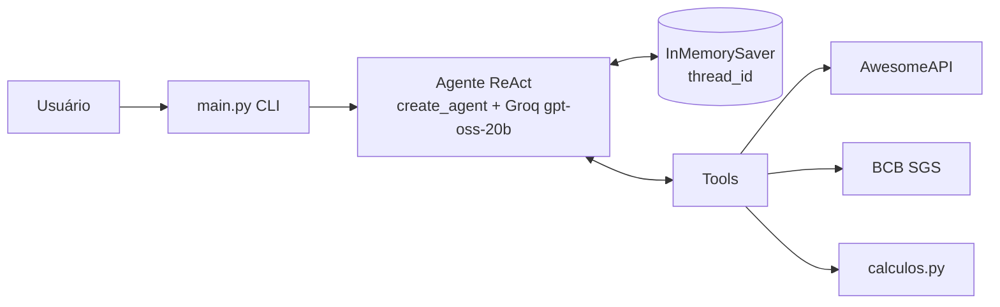

# TP3: Assistente Financeiro Pessoal (ReAct Agent + Tools + Memória)

Código: https://github.com/juniorcarvalho/infnet/tree/main/Data-Driven-26E4_3/TP3

## Problema e solução

Pessoas físicas sem familiaridade com planilhas ou matemática financeira têm dificuldade para responder
perguntas como "quanto rendem R$ 5 mil a 1% ao mês por 2 anos? e em dólar hoje?". Esta CLI oferece um agente
conversacional que consulta dados reais (cotações e Selic/CDI), faz cálculos determinísticos via ferramentas e
lembra do contexto da conversa para follow-ups ("e se fossem 3 anos?").

**Público-alvo:** pessoas físicas leigas em finanças.

## Escolha do LLM

Groq com `openai/gpt-oss-20b`: suporta *tool calling* de forma confiável, é rápido, tem camada gratuita e expõe
uma API compatível com OpenAI (usada via `langchain-openai`). Pode ser trocado por `MODEL_NAME`/`GROQ_BASE_URL` no `.env`.

## Funcionalidades

- Cotação de moedas em tempo real (AwesomeAPI).
- Selic e CDI atuais (BCB SGS).
- Juros compostos com aportes mensais, taxa mensal ou anual.
- Conversão BRL ↔ moeda estrangeira.
- Memória de conversa (`InMemorySaver`) e rastro ReAct visível (`/passos`).

## Arquitetura



## Tools

| Nome | Descrição | Entrada | Fonte |
|---|---|---|---|
| `consultar_cotacao` | Cotação atual de uma moeda em BRL | `moeda` (USD, EUR, BTC...) | AwesomeAPI |
| `consultar_taxa_juros` | Selic meta ou CDI (% a.a.) | `indicador` (selic/cdi) | BCB SGS (432 / 4389) |
| `calcular_juros_compostos` | Montante, total investido e juros | `capital`, `taxa_percentual`, `meses`, `tipo_taxa`, `aporte_mensal` | cálculo local |
| `converter_moeda` | Converte BRL ↔ moeda | `valor`, `moeda`, `direcao` | AwesomeAPI + cálculo |

Erros de serviço são devolvidos como `"ERRO: ..."` para o agente **observar** a falha e reagir.

## Ciclo ReAct

O LLM decide uma **Ação** (tool call), recebe a **Observação** (retorno da tool) e repete até ter a resposta.
O "Reason" (raciocínio) fica implícito: o modelo `gpt-oss-20b` raciocina internamente e o resultado desse
raciocínio é a escolha da próxima tool e dos argumentos; a CLI exibe o par Ação/Observação (`/passos`).
Rastro real do UC3:

```
Ação: consultar_taxa_juros({'indicador': 'cdi'})
Observação: CDI: 13,65% ao ano (data: 19/11/2026)
Ação: calcular_juros_compostos({'capital': 10000, 'meses': 24, 'taxa_percentual': 13.65, 'tipo_taxa': 'anual'})
Observação: Montante final: R$ 12.916,32; total investido: R$ 10.000,00; juros: R$ 2.916,32; taxa mensal efetiva: 1,0720%
Ação: consultar_cotacao({'moeda': 'EUR'})
Observação: 1 EUR (Euro/Real Brasileiro) = R$ 6,5172 em 2026-11-20 19:01:48
Ação: converter_moeda({'direcao': 'brl_para_moeda', 'moeda': 'EUR', 'valor': 12916.32})
Observação: R$ 12.916,32 = 1.981,88 EUR (cotação 6,5172, 2026-11-20 19:01:48)
```

## Memória

`create_agent(..., checkpointer=InMemorySaver())` com `config={"configurable": {"thread_id": ...}}`.
Mesmo `thread_id` = histórico acumulado; `/nova` gera outro `thread_id` e descarta a memória.

## Casos de uso

| # | Cenário | Entrada | Esperado |
|---|---|---|---|
| UC1 | Cotação | "Quanto está o dólar hoje?" | `consultar_cotacao(USD)` |
| UC2 | Cálculo | "Quanto rendem R$ 5.000 a 1% ao mês por 24 meses?" | ~R$ 6.348,67 |
| UC3 | Multi-tool | "R$ 10.000 no CDI por 2 anos? Quanto em euros?" | CDI → juros (anual) → EUR |
| UC4 | Memória | "E se fossem 36 meses?" | reusa capital/taxa |
| UC5 | Memória | "Tenho R$ 2.000." → "Quanto na Selic em 12 meses?" | usa R$ 2.000 + Selic |
| UC6 | Erro | "Cotação da moeda XYZ?" | tool devolve `ERRO:` |
| UC7 | Sem tool | "O que são juros compostos?" | resposta direta |

Resultados observados (LLM real, Groq `openai/gpt-oss-20b`; detalhes em `docs/resultados_casos_de_uso.md`, gerado por `make casos`):

| # | Ferramentas usadas | Resultado |
|---|---|---|
| UC1 | `consultar_cotacao(USD)` | R$ 5,9488 |
| UC2 | `calcular_juros_compostos` | R$ 6.348,67 |
| UC3 | `consultar_taxa_juros(cdi)` → `calcular_juros_compostos(anual)` → `consultar_cotacao(EUR)` → `converter_moeda` | R$ 12.916,32 ≈ € 1.981,88 |
| UC4 | `calcular_juros_compostos` (reusa capital e taxa do UC2) | R$ 7.153,84 |
| UC5 | `consultar_taxa_juros(selic)` → `calcular_juros_compostos(anual)` | R$ 2.275,00 |
| UC6 | `consultar_cotacao(XYZ)` → `ERRO:` | agente informa que a moeda não é suportada |
| UC7 | nenhuma | explicação direta |

## Como executar

```bash
# requer Python 3.10+ (testado com 3.14)
python -m venv .venv
source .venv/bin/activate
pip install -r requirements.txt
cp .env.example .env     # preencha GROQ_API_KEY (gratuita em https://console.groq.com/keys)
python main.py # ou: make run
python -m pytest  # ou: make test (não precisa de chave)
```

Comandos na CLI: `/sair`, `/nova`, `/passos`, `/ajuda`.

## Agente × abordagem manual

Para responder ao UC3 ("R$ 10.000 no CDI por 2 anos? Quanto em euros?") sem o agente, seria preciso:

1. abrir o site do BCB e achar o CDI atual (% a.a.);
2. converter a taxa anual em mensal e montar a fórmula de juros compostos numa planilha;
3. abrir um site de cotações para obter o euro;
4. dividir o montante pela cotação;
5. refazer os passos 2 a 4 a cada variação (outro prazo, outro valor, outra moeda).

São cerca de 5 a 10 minutos por cenário e há risco de erro (taxa anual usada como mensal, cotação desatualizada).
Com o agente, uma pergunta em linguagem natural resolve tudo em segundos (UC3: ~16 s, 4 chamadas de tools), e o
follow-up ("e se fossem 36 meses?") reaproveita o contexto. Os cálculos continuam determinísticos, pois ficam nas tools,
e as respostas citam a data dos dados consultados.

## Uso de IA

- Usado claude code no modelo opus 5.5 para planejar e revisar o que foi implementado.